# Farmling

> *a tiny life on your desktop*

Um fazendeiro de pixel art que vive numa telinha no canto do seu computador. Ele trabalha, ama, tem filhos, faz amigos e inimigos, cria bichos, envelhece, morre e outro recomeça no mesmo mundo, aprendendo com o que deu certo antes. Uma IA que roda **no seu próprio PC** dá voz e imaginação a ele.

*A pixel-art farmer who lives in a little screen in the corner of your desktop. He works, falls in love, raises children and animals, makes friends and rivals, grows old and dies, and the next life starts in the same world, learning from what worked before. An AI running **on your own PC** gives him a voice and imagination.*

<p align="center">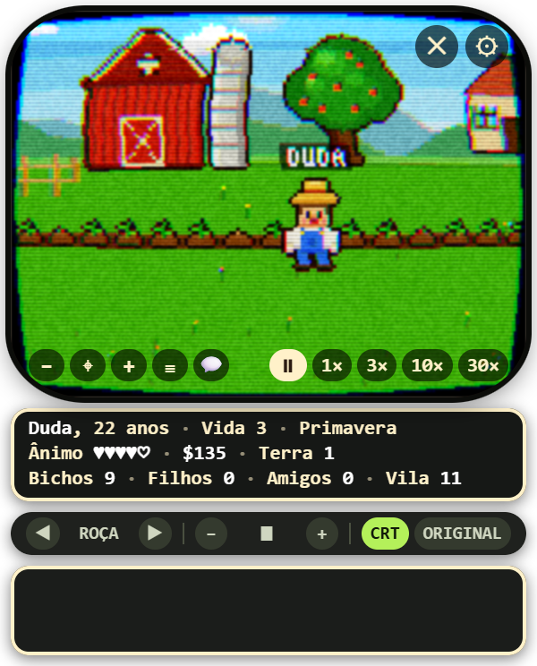</p>

## Capturas de tela / Screenshots

| | |
|---|---|
| 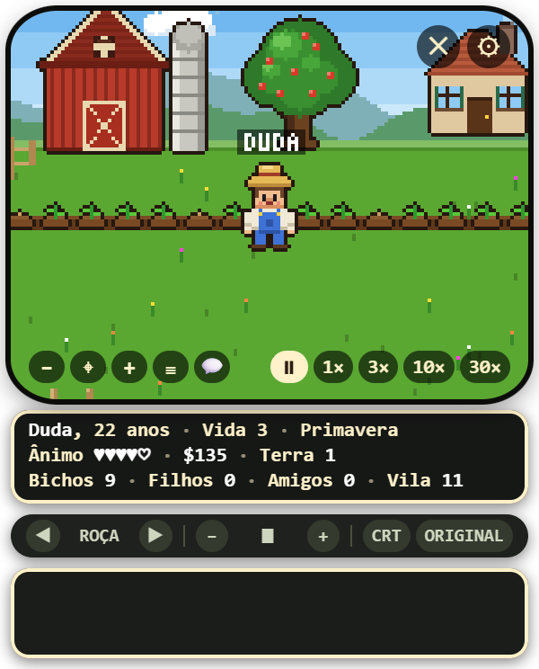<br>**A roça** (a câmera segue o fazendeiro) | 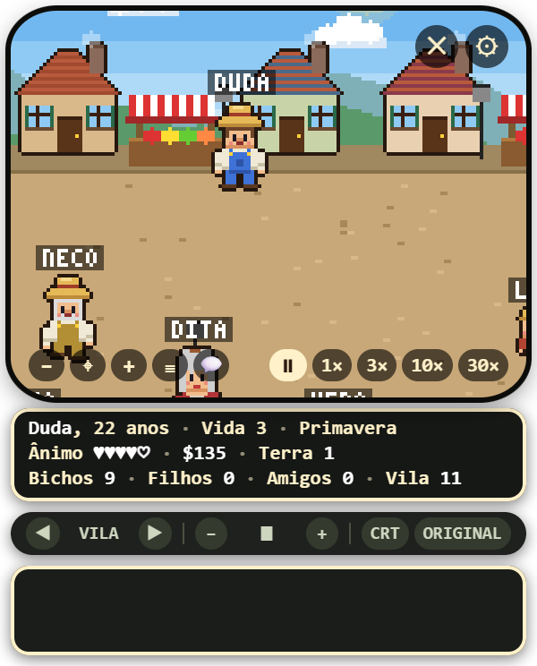<br>**A vila**, com o povo e os nomes |
| 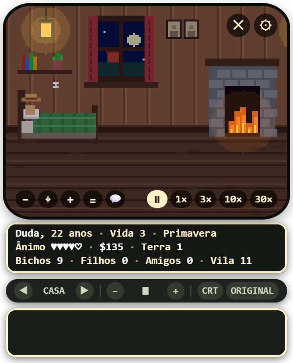<br>**Em casa**, à noite | 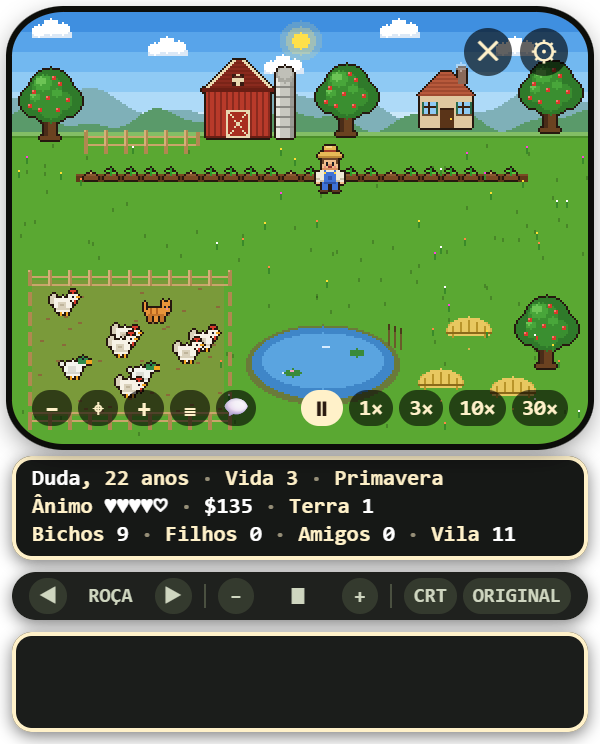<br>**O mapa inteiro** (zoom 1x) |
| 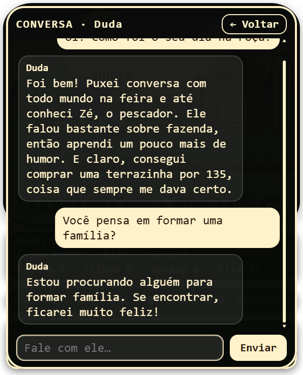<br>**Conversa de verdade** com o fazendeiro (IA local) | 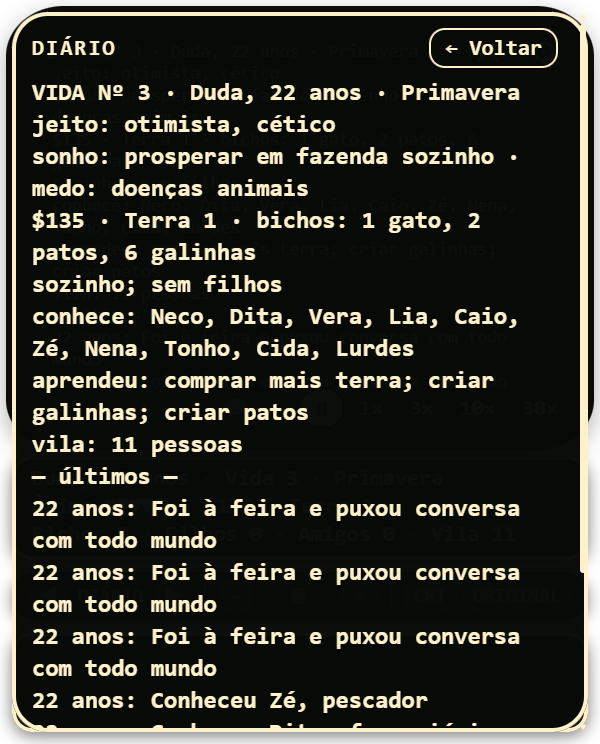<br>**Diário**: o que ele sabe, aprendeu e viveu |
| 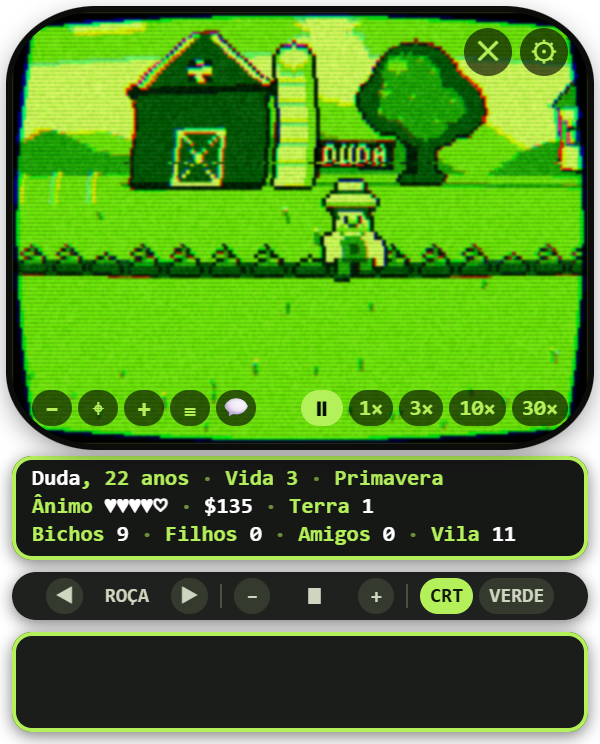<br>Modo **fósforo verde** | 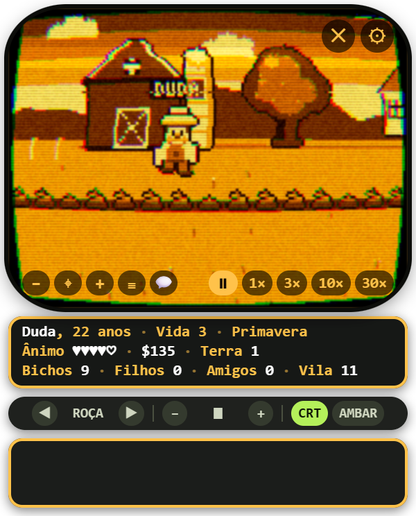<br>Modo **âmbar** |
| 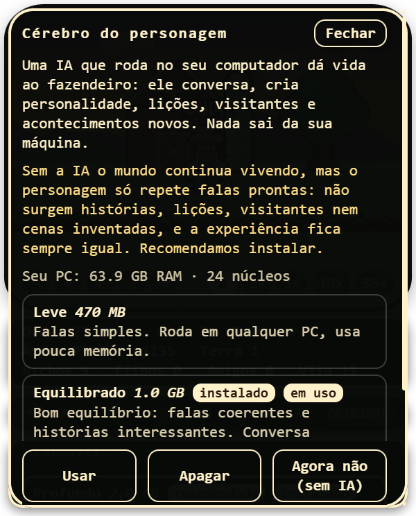<br>**Escolha do "cérebro" de IA** conforme o seu PC | 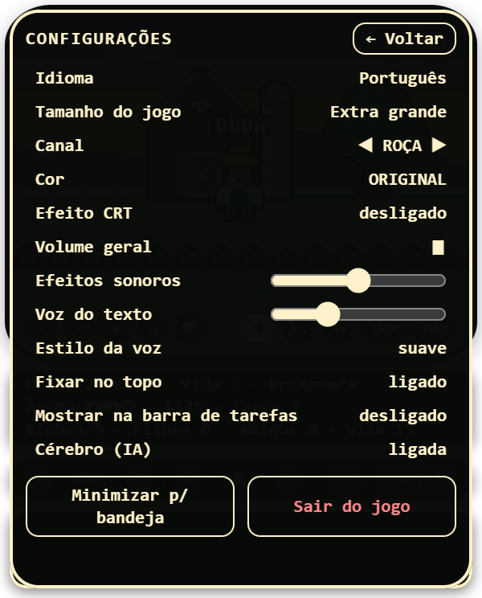<br>**Configurações** (idioma, tamanho, sons, bandeja…) |

## Vídeo explicativo / Explainer video

Clique na imagem para assistir (60 s, ~2,5 MB cada). / Click the image to watch (60 s, ~2.5 MB each).

| Português | English |
|---|---|
| [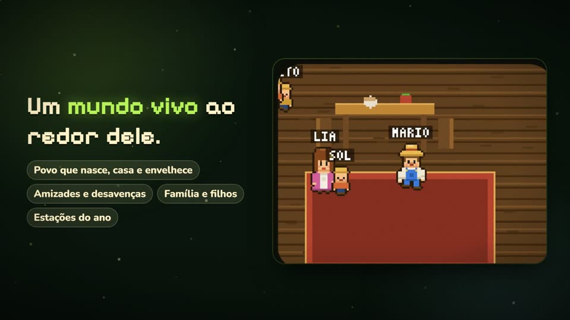](docs/videos/farmling-explicativo-pt.mp4) | [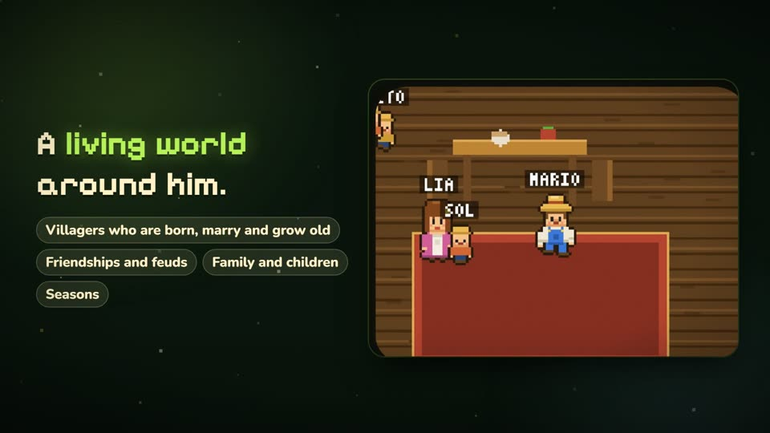](docs/videos/farmling-explainer-en.mp4) |

## Instalar (Windows)

Baixe `Farmling-Setup-x.y.z.exe` na página de Releases e execute. Na primeira abertura o jogo analisa o seu PC e oferece três "cérebros" de IA para baixar:

| Cérebro | Tamanho | Para quem |
|---|---|---|
| Leve (Qwen2.5 0,5B) | ~470 MB | qualquer PC; falas simples |
| Recomendado (Qwen2.5 1,5B) | ~1,1 GB | a maioria dos PCs; falas coerentes e histórias |
| Profundo (Qwen2.5 3B) | ~2 GB | PCs com 12 GB+ de RAM; mais criativo, usa mais CPU |

A IA é opcional. **Sem ela o mundo continua vivendo**, mas o personagem só repete falas prontas: não surgem histórias, lições, visitantes nem cenas inventadas. Dá pra instalar, trocar ou apagar o cérebro depois em ⚙ → Cérebro (IA). Nada sai da sua máquina; a IA roda só na CPU.

## Como é o jogo

- **Mundo vivo:** povo da vila que nasce, casa, tem filhos e morre; amizades, desavenças e pazes; casamento e filhos; 9 espécies de bichos com ciclo de vida (filhote, adulto, velhice) e nomes; estações do ano.
- **Aprende sozinho:** cada decisão (bichos, ferramentas, terra, conviver, poupar) vira uma aposta cujo resultado, 10 meses depois, ajusta o que ele faz da próxima vez. O aprendizado passa de uma vida pra outra.
- **IA:** inventa personalidade (sonho, medo, mania, passado), lições, visitantes e acontecimentos estranhos (ovni, eclipse, tempestade, festival…).
- **Tela:** canais Roça, Casa, Vila e Diário; a câmera segue o fazendeiro; zoom 1x–3x; acelerar o tempo (⏸ 1× 3× 10× 30×); histórico dos acontecimentos (≡); efeito de TV de tubo (CRT).
- **Janela:** arraste em qualquer área; ✕ minimiza para a bandeja (ícones ocultos do Windows); fixar no topo; aparecer na barra de tarefas; 4 tamanhos; português e inglês; volumes separados de efeitos e voz.

## Rodar do código

```
npm install
node node_modules/electron/install.js   # se o npm não rodar o postinstall do Electron
npm start
npm test                                 # autoteste da simulação (sim.js)
```

## Gerar o instalador

```
npm run dist     # cria dist/Farmling-Setup-x.y.z.exe
```

O instalador **não leva modelo de IA dentro**; ele é baixado pelo jogo, direto do Hugging Face, quando o usuário escolhe.

## Estrutura

- `main.js` / `preload.js` — janela, bandeja, IA (node-llama-cpp), download de modelos
- `index.html` — tela, cenas, controles, menus
- `sim.js` — simulação (determinística por seed) e prompts da IA
- `i18n.js` — idiomas (pt, en) e tradução dos textos gerados
- `arte/sprites.js` — sprites de pixel art de 16 bits desenhados em código

## Licenças dos modelos

Qwen2.5 0,5B e 1,5B: Apache 2.0. Qwen2.5 3B: *Qwen Research License* (uso não comercial). Veja as páginas dos modelos no Hugging Face antes de redistribuir.
